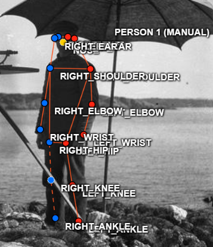
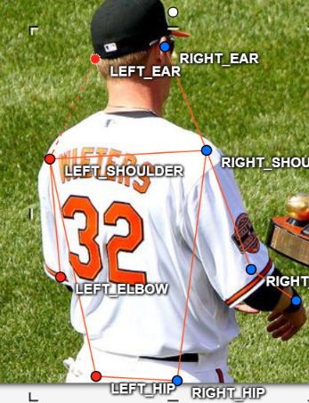
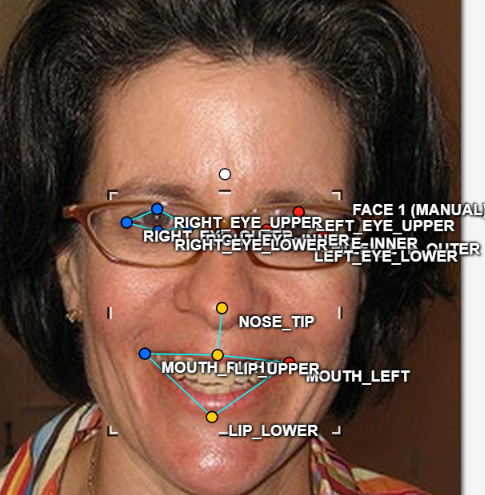
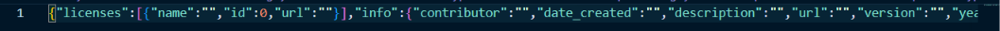

# Báo cáo cá nhân — NguyenBinhAnh-2A202604063

Đổi tên file theo quy tắc `MSSV_HoTen.md`. Ví dụ: `20241234_NguyenVanAn.md`.

Dữ liệu: 12 ảnh người COCO val2017 (Lin et al., 2014) và 8 ảnh chân dung Wikimedia Commons, chỉ dùng trong lớp.

## 0. Thông tin học viên

- Họ tên: Nguyễn Bình Anh
- MSSV: 2A202604063
- Email: binhybc0@gmail.com
- Link repository: https://github.com/binhybc0/K5-L2B-DAY04-Nguyen-Binh-Anh-2A202604063-KeypointPose
- Phiên bản CVAT (Help → About): 2.74.1
- Máy: hệ điều hành Windows · RAM 16 GB · chạy CVAT chế độ đầy đủ
- Bộ ảnh (src/exports/assignment.json do lab.py setup tạo): có
- Giờ bắt đầu: 19:00
- Giờ kết thúc: 23:30

## 1. Kiểm tra label (CP0)

| Label | Kiểu | Số điểm | Tên điểm đúng bảng của lab? | Đúng thứ tự? | Số cạnh |
|---|---|---:|---|---|---:|
| `person` | Skeleton | 17 | Có | Có | 19 |
| `face` | Skeleton | 13 | Có | Có | 13 |

- Mẫu `person` dựng theo người quay mặt về camera (các điểm `left_*` nằm bên phải khung mẫu)? Có
- Cách đổi cờ `occluded` / `outside` cho một điểm trên phiên bản CVAT này (một câu):
  Click chuột phải trực tiếp vào điểm keypoint đó (hoặc chọn điểm và mở menu thuộc tính điểm ở bảng bên phải) rồi bật/tắt tùy chọn `Occluded` hoặc `Outside` cho riêng điểm đó mà không ảnh hưởng đến toàn bộ skeleton.

## 2. Số lượng đã gán và thời gian (CP1, CP2)

| Nhóm ảnh | Số ảnh | Số skeleton đã gán | Số người dưới 60 px (không gán) | Số poster / gương / màn hình bỏ qua | Thời gian (phút) |
|---|---:|---:|---:|---:|---:|
| `easy` | 5 | 7 | 0 | 0 | 25 |
| `occluded` | 3 | 5 | 1 | 0 | 25 |
| `back` | 2 | 2 | 0 | 0 | 18 |
| `small` | 1 | 2 | 2 | 0 | 10 |
| `crowd` | 1 | 3 | 2 | 0 | 15 |
| `faces` | 8 | 8 | — | — | 25 |

*(Tổng cộng: 19 skeleton người trên 12 ảnh và 8 skeleton khuôn mặt trên 8 ảnh).*

- Số ảnh người đã xong ở mốc phút 105: 9 / 10
- Thời gian thực tế (phút): CP1 93 · CP2 25 · CP3 20
- Ảnh tốn thời gian nhất là ảnh nào, vì sao?
  Ảnh `000000309169.jpg` (nhóm `crowd`, có 3 người cần gán) và ảnh `000000183176.jpg` tốn thời gian nhất vì nhiều người đứng chồng chéo lên nhau, nhiều khớp chân/tay bị che khuất một phần hoặc nằm sát mép dưới khung hình nên phải phóng to kiểm tra kỹ hướng người và xác định chính xác cờ `v = 1` hay `v = 0`.

## 3. Bảng ca khó (CP1, CP2)

Mỗi điểm bạn phân vân một dòng, nhất là phân vân giữa `v = 1` và `v = 0`, hoặc không chắc hướng người.

| Ảnh | Người / mặt | Điểm | Cờ đã chọn | Phân vân giữa | Lý do chọn |
|---|---|---|---|---|---|
| `000000069971.jpg` | Người #1, #2 | `left_knee`, `right_knee`, `left_ankle`, `right_ankle` | `v = 0` (`outside`) | `v = 1` và `v = 0` | Hai người ngồi sau bàn/vật cản che mất toàn bộ phần thân dưới từ đầu gối trở xuống, không đủ căn cứ hình học để ước lượng chính xác vị trí cổ chân nên đặt `outside` (`v = 0`). |
| `000000179201.jpg` | Người #1, #2 | `left_hip`, `right_hip`, `left_knee`, `right_knee` | `v = 0` (`outside`) | `v = 1` và `v = 0` | Khung hình cắt ngang phần thân trên, toàn bộ phần hông và chân nằm hoàn toàn ngoài mép dưới ảnh nên bắt buộc đặt `outside` (`v = 0`). |
| `000000183176.jpg` | Người #1 | `left_ankle`, `right_ankle` | `v = 0` (`outside`) | `v = 1` và `v = 0` | Đầu gối vẫn nằm trong ảnh (`v = 2`) nhưng hai bàn chân và cổ chân bị cắt bởi mép dưới khung hình nên chọn `v = 0` thay vì kéo điểm về sát mép ảnh. |
| `000000183176.jpg` | Người #2 | `nose`, `left_eye`, `right_eye`, `right_ear` | `v = 0` (`outside`) | `v = 1` và `v = 0` | Người này quay lưng/nghiêng khuất hẳn khuôn mặt, chỉ thấy tai trái và phần thân nên đặt `v = 0` cho các điểm trên mặt bị khuất hoàn toàn. |
| `face_99874.jpg` | Mặt #1 | `left_eye_*`, `right_eye_*` (8 điểm mắt) | `v = 1` (`occluded`) | `v = 2` và `v = 1` | Nhân vật đeo kính râm tối màu che khuất trực tiếp đồng tử và mép mí mắt, nhưng vẫn thấy rõ gọng kính và hốc mắt để ước lượng chính xác vị trí nên đặt `occluded` (`v = 1`). |

## 4. Bảng tự review (CP3)

Đi từ ảnh cuối về ảnh đầu. 5 ảnh người (ít nhất 2 ảnh `back` hoặc `crowd`) và 3 ảnh mặt. Ít nhất 8 dòng, kể cả dòng `ok`. Ghi lỗi trước, sửa sau.

Mã lỗi dùng đúng một trong: `lr_swap`, `vis_flag`, `position`, `missing`, `extra`, `ok`.

| Ảnh | Người / mặt | Điểm | Mã lỗi | Ghi chú | Đã sửa? |
|---|---|---|---|---|---|
| `000000445187.jpg` | Người #1 | `right_elbow`, `right_wrist` | `vis_flag` | Cánh tay phải bị thân người che khuất hoàn toàn khi xoay người, ban đầu để nhầm `v = 1` nên đã chuyển sang `outside` (`v = 0`). | Đã sửa |
| `000000351176.jpg` | Người #2 | `nose`, `left_eye`, `right_eye` | `vis_flag` | Người quay góc khuất mặt nhưng vẫn để cờ `v = 2`, đã chỉnh lại thành `outside` (`v = 0`) cho đúng quy tắc. | Đã sửa |
| `000000309169.jpg` | Người #1 | `left_knee`, `right_knee`, `left_ankle`, `right_ankle` | `ok` | Kiểm tra lại cảnh báo ngược phía: hai chân người này đang bắt chéo thật theo tư thế đứng nên giữ nguyên tọa độ trái/phải. | Đã kiểm tra |
| `000000308257.jpg` | Người #1 | `left_ankle`, `right_ankle` | `ok` | Kiểm tra lại cảnh báo ngược phía: tư thế bước/vắt chéo chân tự nhiên khiến hai cổ chân nằm ngược chiều so với hông, đã xác nhận đúng tên trái/phải. | Đã kiểm tra |
| `000000183176.jpg` | Người #1 | `left_ankle`, `right_ankle` | `position` | Ban đầu đặt cổ chân hơi sát mép dưới ảnh, đã bật `outside` (`v = 0`) để không làm sai lệch tọa độ huấn luyện. | Đã sửa |
| `face_99874.jpg` | Mặt #1 | `left_eye_upper`, `right_eye_upper` | `vis_flag` | Đã kiểm tra lại 8 điểm của hai mắt sau tròng kính râm tối màu, xác nhận đều đã bật cờ `occluded` (`v = 1`). | Đã kiểm tra |
| `face_92028.jpg` | Mặt #1 | Toàn bộ 13 điểm | `ok` | Các điểm mép mí trên/dưới và khóe miệng bám sát đường viền mắt/môi, đúng trái/phải theo người trong ảnh. | Đã kiểm tra |
| `face_421231.jpg` | Mặt #1 | `left_eye_inner`, `right_eye_inner` | `position` | Khóe mắt trong hơi lệch vào sống mũi 2 px, đã phóng to và kéo lại đúng góc mắt. | Đã sửa |

Tổng hợp số lỗi theo mã:

| `lr_swap` | `vis_flag` | `position` | `missing` | `extra` | `ok` |
|---:|---:|---:|---:|---:|---:|
| 0 | 2 | 2 | 0 | 0 | 4 |

Điểm còn phân vân giữa `v = 1` và `v = 0` (ghi cả hai lựa chọn và lý do chọn):
Ở ảnh `000000183176.jpg` (Người #1), hai khớp đầu gối vẫn nằm trọn trong khung hình nên để `v = 2`, nhưng hai khớp cổ chân (`left_ankle`, `right_ankle`) nằm ngay sát/vượt qua mép dưới ảnh. Em phân vân giữa việc ước lượng sát mép (`v = 1`) và đánh dấu ngoài ảnh (`v = 0`), cuối cùng chọn `v = 0` (`outside`) vì theo quy tắc của lab, điểm nằm ngoài khung hình tuyệt đối không được kéo về mép ảnh để tránh làm model học sai vị trí khớp.

## 5. Kiểm file xuất và kết quả tự kiểm (CP4)

Tự kiểm tay trong file JSON:

| File | Người / mặt kiểm (ảnh, thứ tự) | Số phần tử `keypoints` | Điểm `outside` ra `v = 0`, `occluded` ra `v = 1`? | `num_keypoints` khớp? |
|---|---|---:|---|---|
| `NguyenBinhAnh_persons.zip` | `000000069971.jpg` (id: 2, người #1) | 51 | Có (4 điểm chân `v = 0`, 4 điểm tay/hông `v = 1`) | Có (`num_keypoints = 13`) |
| `NguyenBinhAnh_persons.zip` | `000000183176.jpg` (id: 8, người #1) | 51 | Có (2 điểm cổ chân `v = 0`, 3 điểm `v = 1`) | Có (`num_keypoints = 15`) |
| `NguyenBinhAnh_faces.zip` | `face_99874.jpg` (id: 8, mặt #1) | 39 | Có (8 điểm mắt sau kính râm `v = 1`, 5 điểm `v = 2`) | Có (`num_keypoints = 13`) |

- Sau khi xuất, CVAT ghi `occluded` thành `v = 1` và `outside` thành `v = 0`. Tọa độ của điểm `outside` trong file là `0, 0` hay tọa độ cũ? `tọa độ cũ`
- Hai job đã chuyển sang `completed` trên CVAT? Có

Dán phần TÓM TẮT in ra từ `src/check_submission.py`:

## 6. Ảnh chụp màn hình

1. Label `person` trong label constructor (đủ 17 điểm có tên):



2. Một người quay lưng đã gán, cờ đã đặt:



3. Một khuôn mặt đã gán 13 điểm, phóng to vùng mắt:



4. Một đoạn JSON xuất của một người:



## 7. Tự đánh giá

1. Lỗi bạn mắc nhiều nhất hôm nay, và cách bạn sẽ tránh ở dự án thật:
   Lỗi mắc nhiều nhất là nhầm lẫn cờ visibility (`vis_flag`) giữa `v = 1` (bị che nhưng đoán được) và `v = 0` (ngoài ảnh hoặc không thể đoán chắc) ở các khớp chân/mặt bị cắt sát mép ảnh. Ở dự án thật, tôi sẽ áp dụng quy tắc kiểm tra ngược từ ảnh cuối về ảnh đầu kết hợp bật hiển thị tên điểm và lọc riêng các điểm có cờ `occluded` để rà soát tập trung trước khi bàn giao.

2. Một quy tắc bạn đề xuất thêm vào guideline (kèm ảnh ví dụ nếu có):
   Bổ sung quy tắc chi tiết cho trường hợp **khớp nằm ngay sát đường biên khung hình (trong khoảng 1–3 pixel tính từ mép ảnh)**: nếu tâm khớp đã chạm hoặc vượt ra ngoài biên ảnh thì bắt buộc gán `outside` (`v = 0`), chỉ gán `v = 1` hoặc `v = 2` khi toàn bộ vùng khớp thực sự nằm trọn bên trong khung ảnh.

3. Nhãn của bạn đi vào model ở đâu? Chọn một lỗi bạn đã sửa và nói nó sẽ làm model học sai thế nào (heatmap, trọng số trong loss, hay bước lật ảnh):
   Nhãn keypoint đi vào model pose 2D (như HRNet, RTMPose, YOLO-Pose) dưới dạng các bản đồ nhiệt (heatmap) 2D có đỉnh tại tọa độ `(x, y)` của từng khớp, trong đó cờ `v` đóng vai trò làm mặt nạ trọng số (mask) quyết định khớp nào được tính vào hàm mất mát (loss). Với lỗi `vis_flag` tôi đã sửa (để nhầm `v = 1` thay vì `v = 0` cho khớp nằm ngoài ảnh), nếu giữ nguyên thì tọa độ cũ bị kéo về sát mép ảnh sẽ được gán trọng số `> 0` trong hàm loss, ép model học cách dự đoán sai các khớp người luôn dính chặt vào viền khung hình mỗi khi người bị cắt nửa thân.

## 8. Khó khăn và lỗi kỹ thuật

- Quá trình khởi tạo và chạy CVAT phiên bản `2.74.1` trên Docker ổn định, xuất file COCO Keypoints 1.0 không gặp lỗi định dạng (`0 [LỖI]`).
- Khó khăn chủ yếu gặp phải là xác định đúng hướng trái/phải và cờ visibility cho các ca người quay lưng, đứng vắt chéo chân (`000000308257.jpg`, `000000309169.jpg`) hoặc người bị cắt sát mép dưới khung hình (`000000183176.jpg`). Ngoài ra, khi hiển thị tên tất cả các điểm keypoint cùng lúc trên CVAT ở các vùng nhỏ như khuôn mặt và đầu người, chữ bị chồng đè lên nhau gây khó nhìn, đã khắc phục bằng cách phóng to tối đa từng vùng khớp trước khi đặt điểm.

## 9. Tài liệu tham khảo và công cụ AI đã dùng

- Tài liệu hướng dẫn thực hành Lab Keypoint Pose (K5-L2-DAY04) và bộ dữ liệu chuẩn COCO val2017 / Wikimedia Commons.
- Công cụ CVAT (v2.74.1) và script kiểm tra `src/check_submission.py`.
- Công cụ AI (Gemini) hỗ trợ giải đáp quy tắc gán nhãn (`occluded`, `outside`).
```text
----- TÓM TẮT (dán vào báo cáo mục 5) -----
- File person: NguyenBinhAnh_persons.zip
  Số ảnh: 12 · số skeleton `person`: 19 · mỗi annotation 51 số
  Skeleton theo ảnh: 000000057978=1, 000000069978=2, 000000147780=2, 000000179201=2, 000000183176=2, 000000196283=1, 000000225138=1, 000000253584=1, 000000308257=1, 000000309169=3, 000000351176=2, 000000445187=1
  Cờ v: v=2 204 (63%) · v=1 74 (23%) · v=0 45 (14%)
  num_keypoints trung bình: 14.6
- File face: NguyenBinhAnh_faces.zip
  Số ảnh: 8 · số skeleton `face`: 8 · mỗi annotation 39 số
  Skeleton theo ảnh: face_143959=1, face_145621=1, face_159828=1, face_264124=1, face_362568=1, face_421231=1, face_92028=1, face_99874=1
  Cờ v: v=2 96 (92%) · v=1 8 (8%) · v=0 0 (0%)
  num_keypoints trung bình: 13.0
- Ghi chú: 45 điểm v = 0 vẫn mang tọa độ cũ (CVAT 2.x xuất như vậy; chuẩn COCO ghi 0, 0). Không phải lỗi: điểm v = 0 bị bỏ qua khi huấn luyện và khi chấm.
- Số [LỖI]: 0 · số [CẢNH BÁO]: 2
Kết quả: ĐẠT (đọc lại từng cảnh báo ở trên)